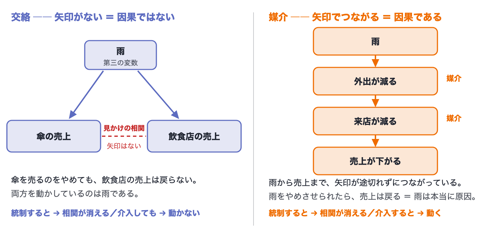
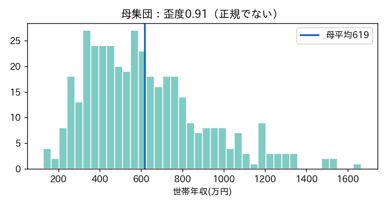
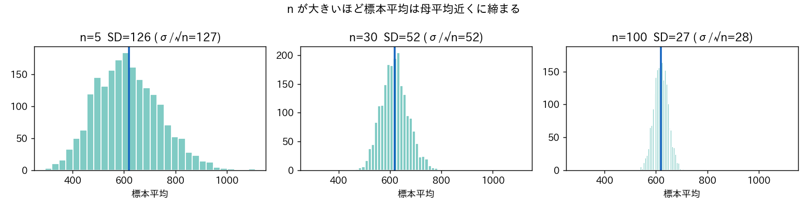
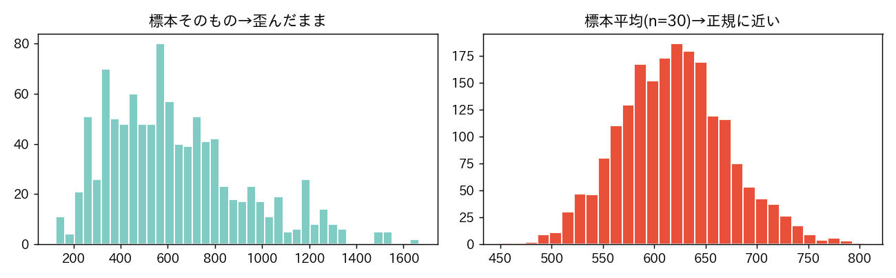

<!-- _class: lead -->
# 第6回　確率分布と標本
## 中心極限定理 ―― なぜ一部で全体が分かる

統計学Ⅰ（B）　北星学園大学
小野原 彩香

---

<!-- _class: lead -->
# 前回の補足
## 交絡と「媒介」は違う

---

## 第5回で3つ挙げた ―― もう1つある

**交絡・逆因果・偶然**。説明が足りなかったのが **媒介**

- **交絡**： $X \leftarrow Z \rightarrow Y$　XとYの間に矢印が**ない** → 因果では**ない**
- **媒介**： $X \rightarrow M \rightarrow Y$　矢印で**つながっている** → 因果で**ある**

 

## 媒介は「因果の一種」

ほとんどの因果は何かを媒介する
運動→体重減→血圧低下／教育→収入→健康
→ 「媒介だから因果でない」とすると、因果がほぼ全部消える

---

## 同じ「雨」で、2つを並べる

---

## 統計だけでは区別できない

| | 交絡 | 媒介 |
|---|---|---|
| 第三の変数を統制すると | 相関が消える | **相関が消える** |
| $X$ に介入すると $Y$ は | **動かない** | **動く** |

 

## 「統制したら消えた」だけでは何も決まらない

決めるのは **時間順序と仕組み**
$X$ より**前**にあるのが交絡、$X$ の**後**に来るのが媒介

---

## 第5回の体重は、どちらだった？

離乳日齢×行動圏 $r=0.657$ → 体重を統制して $0.051$

- 体の大きさが**先** → **交絡**。離乳に効果はない
- 離乳が**先**（離乳が遅い→体が大きい→行動圏が広い） → **媒介**。効果は**ある**

 

## 数字はどちらでも 0.051

体サイズのほうが根本的な変数だから交絡と読んだ
―― **この判断は相関係数の外から持ち込んでいる**

---

## フック：なぜ「一部」で「全体」？

- 視聴率は全国数千万世帯のうち**数百世帯**だけ調べる
- 味噌汁の味見は**ひと匙**で分かる

 

## なぜ一部で全体を語れる？

その裏づけ＝**中心極限定理**

---

## 母集団と標本

- **母集団**：知りたい全体
- **標本**：実際に調べる一部

母集団 μ=5,881 g / σ=13,110 g / 歪度**7.60**（**正規からほど遠い**）

---

## 標本平均を2000回くりかえすと…

母集団は歪んでいた。標本平均(n=30)の分布は？

- 標本平均の平均 ≈ **5,850 g**（母平均5,881にほぼ一致）
- ばらつき SD ≈ **2,300 g**（理論値 σ/√n = 2,394）
- 歪度 7.60 → **約1.5**（近づいた。ただしまだ0ではない）

## ＝中心極限定理(CLT)

---

## n を増やすと「締まる」

$$ 標準誤差\ SE = \frac{\sigma}{\sqrt{n}} $$

n を4倍 → SE は半分（精度2倍に4倍のデータ）

---

## 「標本」≠「標本平均の分布」

正規に近づくのは**標本平均の分布**。標本そのものは歪んだまま。

---

## ただし「無作為」が大前提

- 「声の大きい人」ばかり選ぶ → 数を増やしても**偏ったまま**
- 空気を読んで答えをそろえる → **独立性**が壊れる

 

## 数の多さは、偏りを直さない

「たくさん集めた」≠「正しく集めた」

---

<!-- _class: lead -->
# まとめ

## 標本平均はCLTで正規分布に従う
## だから一部から全体を語れる

### ただし無作為抽出が大前提
### 次回：点推定と区間推定／信頼区間95%の本当の意味
