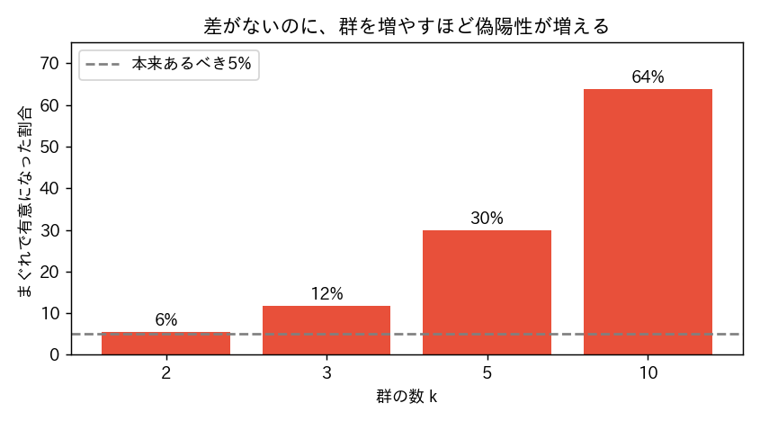

<!-- _class: lead -->
# 第9回　仮説検定(2)
## 分散分析(ANOVA)と多重比較

統計学Ⅰ（B）　北星学園大学
小野原 彩香

---

## フック

> 3つの科で体重に差がある？
> 「**全ペアでt検定**すればいいよね？」
> オマキとクモ、クモとコビト、オマキとコビトの3組。

<br>

## <span class="big">どの比較をひとまとまりにするか？</span>

---

## 多重比較とは何か

多重比較とは、一つの問いに答えるために複数の比較を行うこと。

<br>

3科の全ペアは3比較、6食品をそれぞれ対照と比べるなら6比較。
1比較につき5%でも、全体で一度でも誤って有意とする確率は上がりうる。

---

## 多重比較の罠（差がないのに）



群が増えるとペア数が増え、差がなくても「1組以上が有意」が増える。

---

## だから ANOVA

3群以上を**1回**で「**どこかに差があるか**」判定
→ 検定を繰り返さないので偽陽性が増えない

```python
F, p = stats.f_oneway(*群)
```

3科の対数体重を比較 → **F=151.89, p=3e-25**
→ 3科の対数体重の母平均がすべて等しいという仮説を棄却する。

---

## F値の気持ち

$$ F = \frac{\text{群間のばらつき（平均の違い）}}{\text{群内のばらつき（個人差）}} $$

- F 大 ＝ グループ差が個人差より大きい → 差あり
- F ≒ 1 は、群間と群内の平均平方が近いことを表す。

---

## 有意だったら：事後検定＋補正

ANOVAが言うのは「**どこかに**差がある」まで

- どのペアかは**事後検定**で
- 繰り返すので**ボンフェローニ補正**（α÷回数）

<br>

❌「ANOVA有意 ＝ 全部の群が違う」（どこかに差、だけ）

---

<!-- _class: lead -->
# まとめ

## 全群の母平均をまとめて調べる
## 全体の差はANOVA、個別の差は補正した比較で調べる

### 「有意」＝どこかに差、≠ 全部違う
### 次回：回帰分析 ―― データを数式で説明する
